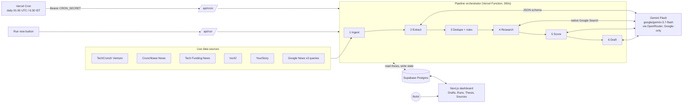
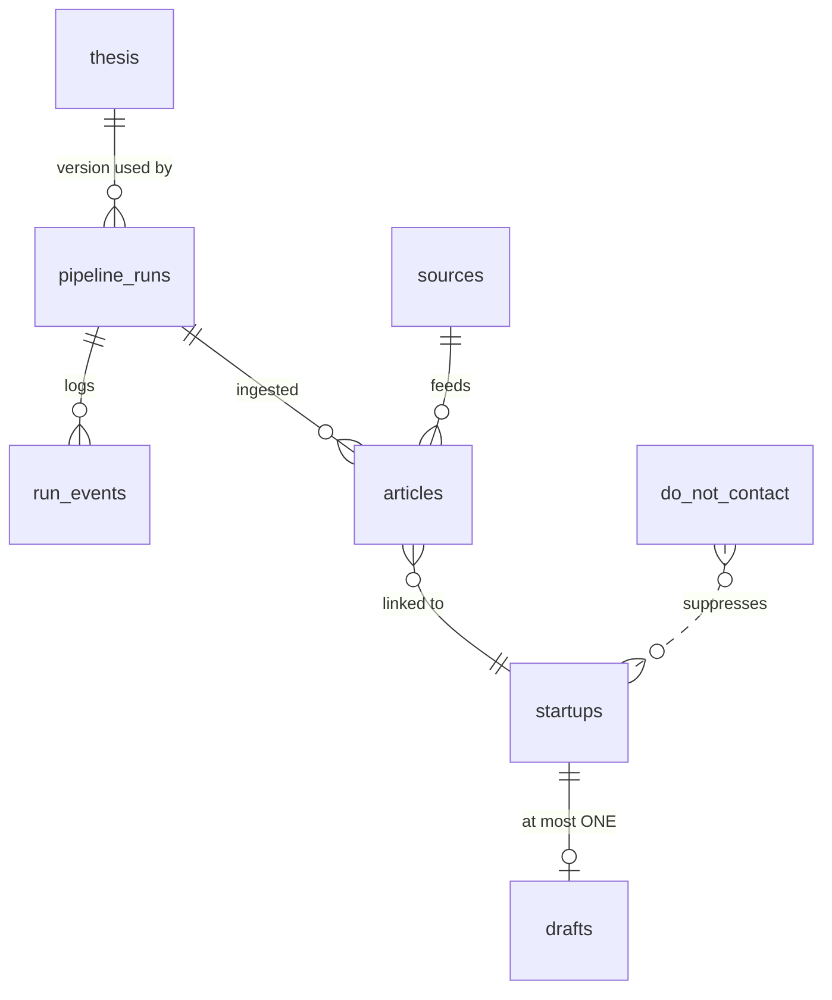

# Components Map: Timed Funding Outreach Engine

**Live app:** https://funding-outreach-engine-chi.vercel.app · **Interactive version:** [/how-it-works](https://funding-outreach-engine-chi.vercel.app/how-it-works)

**Problem:** Rohit misses 30–40% of seed and pre-seed announcements and spends about 20 minutes per startup on research and writing. **Outcome:** every morning, researched and personalised drafts for startups that fit, produced within hours of each announcement. Startups that don't fit are never shown, and no startup is ever contacted twice.

## 1. System architecture

## 2. Pipeline stages

| # | Component | Input → Output | AI? | Key logic | Failure handling |
|---|-----------|----------------|-----|-----------|------------------|
| 0 | **Scheduler**: `vercel.json`, `api/cron` | time → run | — | Daily cron, authenticated with a secret bearer token. A manual trigger is available on the dashboard. | 401 without the secret. 409 if a run is already in progress. |
| 1 | **Ingest**: `pipeline/ingest.ts` | 8 RSS feeds → `articles` | No | Fetches feeds in parallel. Keeps items inside the lookback window (24h, from the thesis) that pass a funding-keyword check. Removes tracking parameters from URLs and drops duplicate headlines. | 15-second timeout per feed. A failed feed is logged and skipped. `UNIQUE(url)` means an article is never processed twice. |
| 2 | **Extract**: `pipeline/extract.ts` | article → funding facts | **Gemini** | Batches of 10, strict JSON schema output: company, round, amount in USD, investors, sector, founders, website. Rejects VC fund closes, roundups and rumours. | A failed batch leaves its articles as `new`, so they're retried next run. |
| 3 | **Dedupe + hard rules**: `extract.ts`, `dedupe.ts`, `normalize.ts` | facts → `startups` row or skip | No | Exact match on normalised name and domain against every startup ever seen and the do-not-contact list, then a fuzzy match: core name ("X" = "X AI"), shared founder, or same round + amount + investor. Re-checked just before drafting. Stage must be in `thesis.target_stages`. Raise must be within the min/max. | Database unique constraints catch race conditions (`23505` is treated as a duplicate). |
| 4 | **Research**: `pipeline/research.ts` | startup → research brief | **Gemini + Google Search** | Live web research on product, customers, traction, founders and website, with source citations. | If grounding fails, it falls back to the announcement text. A domain clash with a known startup means it's a duplicate. |
| 5 | **Score**: `pipeline/score.ts` | startup + **thesis from DB** → 0–100 | **Gemini** | Per-criterion scores (sector, stage, geography, team, demand, timing), plus reasons, concerns and personalisation hooks. Below `fit_threshold` → rejected and hidden. | Retried up to 3 times, then parked in the `error` state (dead-letter). |
| 6 | **Draft**: `pipeline/draft.ts` | fit startup → email | **Gemini** | 110–160 words that reference the round, the investors and the product. Tone, sender and call to action come from the thesis. Uses only the facts provided, with no placeholders. | `UNIQUE(drafts.startup_id)` means the database refuses a second draft. |
| 7 | **Review UI**: `app/page.tsx` | drafts → approved / sent | No | Rohit can edit, approve, open in his mail client, copy, mark sent or discard. Each card shows the fit breakdown and sources. | Status changes are persisted. Sent startups stay deduplicated forever. |

## 3. Data model (Supabase)

| Table | Purpose | Notable constraints |
|-------|---------|---------------------|
| `thesis` | Accelerator thesis, **edited by Rohit and re-read every run** | Exactly one active row (partial unique index). Each save is a new version. |
| `sources` | RSS feeds to monitor | Add or disable feeds without code changes |
| `articles` | Every news item seen | `UNIQUE(url)` |
| `startups` | One row per company, with a state machine `new → researched → fit/rejected → drafted` | `UNIQUE(normalized_name)`, `UNIQUE(domain)` |
| `drafts` | Outreach emails | `UNIQUE(startup_id)` means no duplicate outreach |
| `pipeline_runs`, `run_events` | Observability: funnel stats, AI cost, full event log | Partial unique index: only one run can be `running` |
| `do_not_contact` | Companies contacted outside the system | `UNIQUE(normalized_name)` |

Security: RLS is enabled on every table with no policies, so the public anon key can read nothing. Only server code using the service-role key can access data. Secrets live only in Vercel env vars.

## 4. Reliability guarantees

1. **No duplicate outreach.** This is enforced by database constraints, not just application code, so even overlapping runs can't create two drafts.
2. **Resumable runs.** Stages read their work from the database by status. If a run times out, the next run continues from there. Within a run, the orchestrator keeps processing the backlog while time remains.
3. **One run at a time.** An atomic lock is implemented as a unique index. A run stuck for more than 10 minutes is marked failed.
4. **Graceful degradation.** A failed feed is skipped. If grounding fails, research falls back to the announcement. Failed Gemini calls are retried with backoff (429/5xx). A 402 (out of credits) stops immediately with a clear error.
5. **Auditable decisions.** Every score stores its thesis version and per-criterion reasoning, and every run stores funnel stats and its AI cost.

## 5. Configurability without code changes

| What Rohit changes | Where | Takes effect |
|--------------------|-------|--------------|
| Thesis text, sectors, stages, geographies, raise bounds, fit threshold | Thesis page or Supabase `thesis` table | Next run |
| Email tone, sender, program pitch, call to action | Thesis page or Supabase | Next run |
| Lookback window | Thesis page | Next run |
| News sources | Sources page or Supabase `sources` | Next run |
| Do-not-contact list | Sources page | Immediately |

## 6. Technical trade-offs

| Decision | Why | Cost |
|----------|-----|------|
| Free RSS and Google News instead of the Crunchbase API | Live, free, broad coverage | Messy text, handled by LLM extraction |
| Keyword check before the LLM | About 50% fewer Gemini calls | A small risk of missing unusual headlines |
| Deterministic rules plus LLM scoring | Hard rules are predictable and free, and nuanced fit comes with explanations | Two places to configure (both in the thesis) |
| Research before scoring | Better scoring accuracy | Search cost (~$0.03) on startups that may then be rejected |
| Drafts instead of auto-send | Rohit keeps control, and founder emails aren't guessed | One click per email |
| Daily cron with in-run backlog processing | Fits the Vercel Hobby limits | Announcements are at most 24h old by the next morning |
